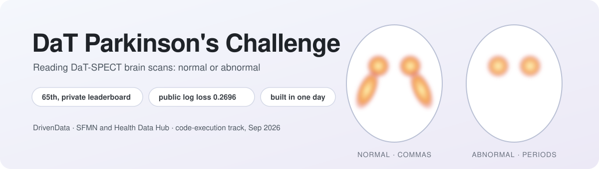

<p align="center">
  
</p>

<p align="center">
  <a href="https://www.drivendata.org/competitions/311/">Competition</a> ·
  <a href="#approach">Approach</a> ·
  <a href="#layout">Layout</a> ·
  <a href="#reproduce">Reproduce</a>
</p>

A DaT-SPECT classifier for DrivenData's [DaT Parkinson's Challenge](https://www.drivendata.org/competitions/311/): it reads a 3D brain
scan and says whether the dopamine transporter signal is normal or abnormal. It finished **65th on the private leaderboard**, and it was
built, trained and submitted **in a single day** on a MacBook.

## Result

| Private leaderboard | **65th** |
|---|---|
| Public log loss | 0.2696 |
| Local 5-fold out-of-fold log loss | 0.2585 |
| Local-to-public gap | 0.011 |
| Submission size | 48 MB, with each CNN packed to 2.8 MB in int8 |

## Approach

The signal that matters sits in two small structures, the left and right striatum. A healthy scan shows two bright commas; an abnormal
scan shrinks them toward periods. The pipeline finds the striatum first and spends all of its capacity there.

**Preprocessing** (`src/prep.py`): resample to 2 mm isotropic RAS, locate the striatal complex (smoothed hotspot near the brain
centroid, then intensity-weighted centroid), crop a 96 x 128 x 128 mm box, and build two channels: intensity over striatal peak, and
intensity over the brain-background median, clipped to [0, 12].

**Models**, each 5-fold (stratified by label x acquisition family) x 2 seeds, label smoothing 0.1, left/right flip at test time:

| key | input | model | out-of-fold log loss |
|---|---|---|---|
| `2dt` | 3 axial slabs (2.5D) | ResNet18 truncated after layer3, int8 | 0.291 |
| `2dcor` | 3 coronal slabs | truncated ResNet18, int8 | 0.303 |
| `feat` | 29 striatal features (binding ratios, volumes, extents, asymmetry) | LightGBM / logistic regression | 0.334 / 0.346 |

**Blend**: Platt-scale each model's out-of-fold logits, then weight them by a simplex grid search (`scripts/blend.py`, weights 0.4 /
0.3 / 0.15 / 0.15). The axial CNN, the coronal CNN and the hand-built features see the striatum from three independent angles; together
they reach 0.2585, well below any single model.

**Size**: `src/quant.py` packs a truncated ResNet18 as int8 per output channel: 2.8 MB per model, with a maximum logit drift of 0.4.
The full submission is 48 MB.

## Layout

```
src/prep.py            preprocessing; `python src/prep.py` builds data/cache
src/quant.py           int8 state_dict pack and unpack
src/main_blend.py      the inference entry point (main.py in the submission zip)
submission_src/        submission package: cnn2d.py, extra_models.py, cnn3d.py, Platt calibration json
scripts/               census, make_folds, features, train_*, blend, package
tests/                 int8 round-trip, smoke-set and garbage-input checks
plans/                 build specs
results/               per-model out-of-fold summaries, blend weights, submission log
```

Competition data stays out of the repository, as the competition rules require.

## Reproduce

```
python -m venv .venv && source .venv/bin/activate && pip install -r requirements.txt
# put DrivenData's train_labels.csv and niftis/*.nii.gz under data/
python scripts/census.py         # data/meta_train.csv: voxel size and matrix per scan
python scripts/make_folds.py     # data/folds.csv
python src/prep.py               # data/cache/crops_2mm.npy, 1362 x 2 x 48 x 64 x 64 float16
python scripts/features.py && python scripts/train_feat.py
python scripts/train_2dt.py && python scripts/train_2d_cor.py
python scripts/package.py s1 cnn_2dt cnn_cor feat_lgb feat_lr   # upload/submission_s1.zip
```

Container test: clone [drivendataorg/competition-sfmn-parkinsons-runtime](https://github.com/drivendataorg/competition-sfmn-parkinsons-runtime),
unzip the submission into its `submission_src/`, and follow its README. Platform versions: Python 3.12, torch 2.12.1, torchvision
0.27.1, numpy 2.2.6, scipy 1.15.3, nibabel 5.4.2, pandas 3.0.3, scikit-learn 1.8.0, lightgbm 4.6.0.

## License

MIT
